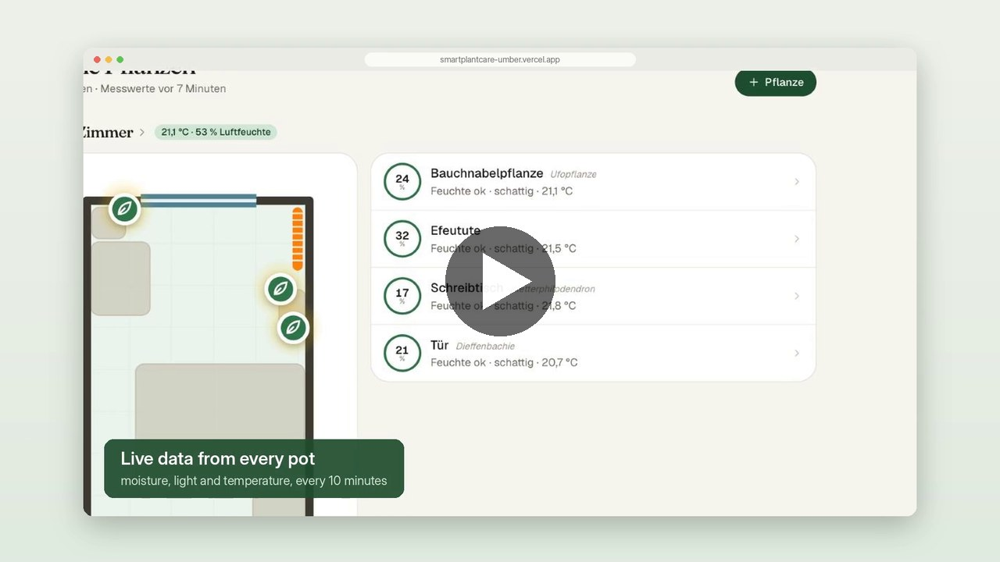

# Smart Plant Care

**Demo (2 Min., Englisch):** Sensoren, Dashboard, Raumplan, Gieß-Lernen und Kosten.

[](docs/demo/smartplantcare-demo.mp4)

## Auf einen Blick

| | |
|---|---|
| **Was** | Ein eigenes IoT-System zur Pflanzenüberwachung, im Alltag in Benutzung. Sensoren messen Bodenfeuchte, Licht, Temperatur und Luftfeuchte; das System lernt, wie jede Pflanze auf Gießen reagiert, und sagt den nächsten Gießzeitpunkt voraus. |
| **Rolle** | Einzelprojekt: Idee, Hardware, Firmware, Backend, Web-App, iPhone-Widget und Garmin-App. |
| **Highlights** | Ende zu Ende: BLE-Sensoren → ESP32-Gateway (M5Stack Atom Lite, ESPHome) → Supabase (EU) → Web-App, iPhone-Widget und Garmin-Uhr.<br>Lernt pro Pflanze, wie viel Wasser einen Prozentpunkt Feuchte bringt und wie schnell der Topf austrocknet, getrennt nach Jahreszeit.<br>Foto-Tagebuch mit KI-Check über die Claude API.<br>Push-Hinweise zu Gießen, Luftfeuchte und Sensor-Ausfall; automatische Winterruhe; Urlaubsmodus.<br>Läuft komplett im Supabase Free Tier, ohne eigenen Server. |
| **Stack** | ESPHome / C++, Supabase (PostgreSQL, Edge Functions in TypeScript, pg_cron, Row Level Security), Next.js als PWA auf Vercel, Scriptable (JavaScript), Garmin Connect IQ (Monkey C), ntfy |

## Architektur

```
Flower Care (HHCCJCY01) ─┐
Govee H5075 ─────────────┼─ BLE ─▶ Atom Lite / ESPHome ─ HTTPS ─▶ Supabase Edge Function `ingest`
                         ┘                                              │
                                                              Postgres (Messwerte, Pflanzen, …)
                                                                        │
                       Edge Function `summary` (nur lesend) ◀───────────┤
                          │                                             │
            iPhone-Widget, Garmin-Glance                 Web-App (PWA) · Push über ntfy
```

## Ordner

| Ordner | Inhalt |
| --- | --- |
| `firmware/` | ESPHome-Konfiguration für das Gateway |
| `backend/` | Supabase: Migrationen und Edge Functions |
| `web/` | Web-App (Next.js) |
| `scriptable/` | iPhone-Widget |
| `garmin/` | Connect-IQ-App für die Forerunner 165 |

Der vollständige Projektplan steht in [PLAN.md](PLAN.md).
